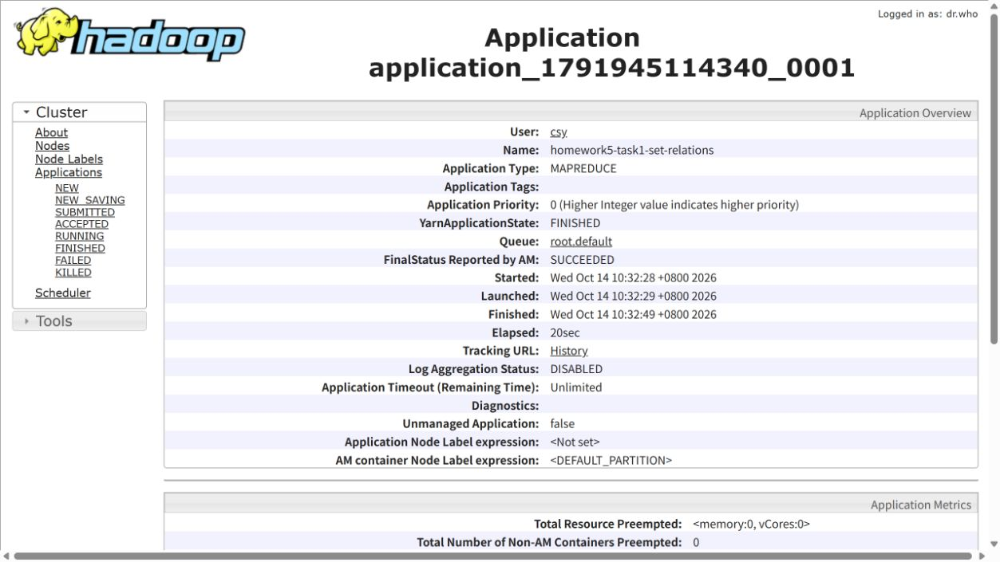
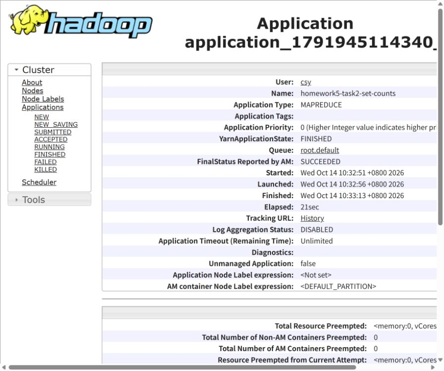

# 金融大数据作业5：指数成分股集合关系与统计

## 1. 作业内容

使用 Java Hadoop MapReduce 对附件 `A.txt`、`B.txt` 进行两阶段处理。第一阶段输出每个“指数编号、股票代码”的集合关系；第二阶段直接读取第一阶段结果，统计交集、A 独有、B 独有和并集。输出采用制表符分隔，不添加表头。

## 2. 项目结构

```text
financial-big-data-homework5/
├── src/main/java/edu/homework/IndexSetRelations.java
├── target/financial-big-data-homework5-1.0.0.jar
├── input/A.txt、B.txt
├── output_task1/part-r-00000、_SUCCESS
├── output_task2/part-r-00000、_SUCCESS
├── screenshots/                  # 两个作业成功的真实 YARN 网页截图
├── logs/                         # 集群日志与独立校验记录
├── scripts/build.sh、run.sh、verify.py、test.sh  # 编译脚本；上传、执行、导出结果脚本；独立核对输出
├── tests/A.txt、B.txt             # 重复记录及排序边界测试数据
├── pom.xml
├── .gitignore
└── README.md
```

## 3. 设计思路

### 任务1：集合关系

使用 `MultipleInputs` 为 A、B 分别指定 Mapper。每条输入以 `(指数编号, 股票代码)` 为组合键；A 的值为二进制掩码 1，B 的值为 2。Combiner 和 Reducer 对掩码做按位 OR 运算。

11=01 or 10

| 聚合掩码 | 集合关系 | 含义 |
|---|---|---|
| 1 | A_ONLY | 只出现在 A |
| 2 | B_ONLY | 只出现在 B |
| 3 | BOTH | 同时出现在 A 和 B |

OR 运算具有结合律、交换律和幂等性，因此同一文件内的重复记录、跨输入分片的重复记录均不会重复计数，且不依赖 Combiner 是否执行。同一股票出现在不同指数时，组合键不同，分别统计。

自定义 `StockKey` 先按指数编号的整数值比较，再按股票代码比较；设置一个 Reducer，使整个输出文件按指数编号升序、股票代码升序排列。输入支持连续空格或制表符，忽略空行；格式错误直接使作业失败，避免悄悄漏算。

### 任务2：二次统计

Mapper 读取任务1的三列结果，以指数编号为键，把关系转换为三维计数向量：`BOTH=(1,0,0)`、`A_ONLY=(0,1,0)`、`B_ONLY=(0,0,1)`。Combiner 和 Reducer 分量求和，最终并集数量为三项之和。计数使用 `long`，避免普通整数计数溢出。

Driver 等待任务1成功后才提交任务2。开始前检查两个输出目录；若已存在则报错，保留原有数据。两阶段均设置单个 Reducer；任务2以 `IntWritable` 作为键，保证指数按数值升序输出。

## 4. 实际运行环境与方法

本次实际使用 Windows WSL2 Ubuntu 24.04 中已有的 Hadoop 3.4.0 伪分布式环境、OpenJDK 8。HDFS 为 `hdfs://localhost:9000`，MapReduce 运行于 YARN。没有重新格式化 NameNode。

本机的Hadoop安装目录：`/home/csy/hadoop_installs/hadoop-3.4.0`

```bash
# 告诉程序java和Hadoop的安装位置
export HADOOP_HOME=/home/csy/hadoop_installs/hadoop-3.4.0
export JAVA_HOME=/usr/lib/jvm/java-8-openjdk-amd64
# 能直接输入java、hadoop、hdfs等命令
export PATH="$HADOOP_HOME/bin:$HADOOP_HOME/sbin:$PATH"

# 使用 Hadoop 已安装的依赖离线编译，不需要另装 Maven。
bash scripts/build.sh

# HDFS、YARN 未启动时，先启动已有环境，切勿重复格式化。
start-dfs.sh
start-yarn.sh
hdfs dfsadmin -safemode wait

# 使用新目录运行；脚本上传附件，执行两个作业并导出本地结果。
bash scripts/run.sh /user/csy/homework5-new-run

# 逐行独立校验两份真实输出。
python3 scripts/verify.py
```

也可用 `mvn clean package` 编译（需联网获取依赖）。`pom.xml` 将 Hadoop 依赖设置为 `provided`，JAR 不重复打包集群依赖。此次实际验证使用 `build.sh` 的 javac/jar 编译方式，而非 Maven。

在 Docker Hadoop 集群中，把项目复制到有 Java 和 Hadoop 的容器内部，以相应 `HADOOP_HOME` 执行同样的构建和运行脚本。中文路径需要 UTF-8 locale，脚本已设置 `C.UTF-8`。

## 5. 实验结果

附件 A 有 285 条记录，B 有 320 条记录，本次附件各自没有重复的组合键。任务1输出 547 条唯一组合记录；任务2输出 3 条统计记录：

| 指数编号 | 交集 BOTH | A 独有 | B 独有 | 并集 |
|---|---:|---:|---:|---:|
| 101 | 3 | 13 | 4 | 20 |
| 102 | 3 | 19 | 3 | 25 |
| 103 | 52 | 195 | 255 | 502 |
| 合计（各指数内计数之和） | 58 | 227 | 262 | 547 |

合计按“指数、股票”组合统计，不是跨指数去重后的股票数量。每个指数均满足 `A数量=交集+A独有`、`B数量=交集+B独有`、`并集=交集+A独有+B独有`。

任务1前几行示例：

```text
101	AAPL	A_ONLY
101	AMGN	A_ONLY
101	AXP	A_ONLY
101	BA	A_ONLY
101	CAT	A_ONLY
```

### YARN 运行证据

2026年10月14日运行的两个应用：

| 阶段 | Application ID | Job ID | 最终结果 |
|---|---|---|---|
| 任务1 | application_1791945114340_0001 | job_1791945114340_0001 | FINISHED / SUCCEEDED |
| 任务2 | application_1791945114340_0002 | job_1791945114340_0002 | FINISHED / SUCCEEDED |

实际 HDFS 输出保存在 `/user/csy/homework5-20261014-run5/output_task1` 和 `/user/csy/homework5-20261014-run5/output_task2`。本地 `output_task1`、`output_task2` 是从这次 HDFS 输出导出的文件，两阶段均检查到 `_SUCCESS`。

任务1启动 2 个 Map、1 个 Reduce，输入 605 条，Reducer 分组和输出均为 547 条。任务2启动 1 个 Map、1 个 Reduce，输入为任务1的 547 条，输出为 3 个指数。完整计数器和作业完成信息见 `logs/hadoop-run.log`。

下图来自本次两个应用各自的 YARN 详情页面





## 6. 验证

`scripts/verify.py` 用独立的 Python 集合运算生成期望结果，与 Hadoop 输出逐行比较，同时检查顺序、关系、去重和统计数量。原始附件校验记录保存在 `logs/verification.txt`。

另使用真实 Hadoop LocalJobRunner 运行小型边界数据，验证文件内重复、A/B 同时存在、同名股票跨指数、只有 A 或 B 的指数，以及指数 2 与 10 的数值排序。共输出 7 条集合关系和 4 条统计记录；重新指定已存在输出目录应失败且不删除旧结果。验证记录见 `logs/edge-case-verification.txt`，执行日志见 `logs/edge-case-mapreduce.log`。

```bash
bash scripts/test.sh
```

## 7. 性能与可扩展性

任务1的 OR Combiner 可压缩大量重复键，任务2的向量 Combiner 可显著减少 Shuffle 数据；Reducer 只保存固定大小聚合状态，不需要将整个股票集合载入内存。此附件没有重复组合键，所以任务1 Combiner 未减少输出记录数。

为满足全局有序、便于提交检查，两阶段目前都使用单个 Reducer。数据规模增大时，该 Reducer 会成为吞吐瓶颈；可使用多个 Reducer 配合 TotalOrderPartitioner 及采样边界，并按分区编号读取或合并结果以保留全局排序。任务2也可按指数分区处理，但指数种类很少时，并行收益有限。两次作业有额外启动及中间 HDFS 写入开销，不过严格保留了题目要求的“对任务1结果进行二次统计”流程。
